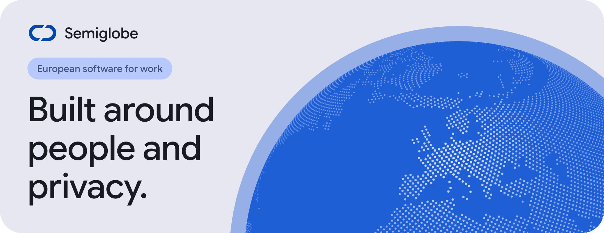
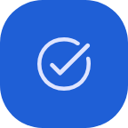
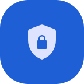
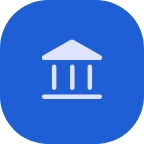

<picture>
  <source media="(prefers-color-scheme: dark)" srcset="https://raw.githubusercontent.com/Semiglobe/.github/main/profile/assets/banner-dark.png?v=3">
  
</picture>

## A private, sovereign workspace for companies and their teams

Semiglobe is a **European B2B software company**. We are bringing communication, productivity, security and, progressively, business management together, so teams can rely on one private place for their daily work.

### What we're building

<table>
  <tr>
    <td width="50%" valign="top">
      

      

      
<strong>Communication</strong> 
      Keeping teams connected, in a shared space that their own company controls.

      

    </td>
    <td width="50%" valign="top">
      

      

      
<strong>Productivity</strong> 
      The everyday tools that people across a company use to get work done together.

      

    </td>
  </tr>
  <tr>
    <td width="50%" valign="top">
      

      

      
<strong>Security</strong> 
      Protection for company accounts, access and the information teams share.

      

    </td>
    <td width="50%" valign="top">
      

      

      
<strong>Business management</strong> 
      The tools to run the company itself, added progressively over time.

      

    </td>
  </tr>
</table>

### What guides us

<table>
  <tr>
    <td width="33%" valign="top">
      

      

      
<strong>Privacy comes first</strong> 
      It shapes how we design software from the start, not after it ships.

      

    </td>
    <td width="33%" valign="top">
      

      

      
<strong>Sovereignty matters</strong> 
      Companies should stay in control of their tools and their information.

      

    </td>
    <td width="33%" valign="top">
      

      

      
<strong>Software is for people</strong> 
      Work tools should be clear, calm and respectful of those who use them.

      

    </td>
  </tr>
</table>

### Where we are today

We are early, and our products are still in development. They will appear here as they become ready.

### Get in touch

Companies and partners can reach us at [semiglobe@gmail.com](mailto:semiglobe@gmail.com).

